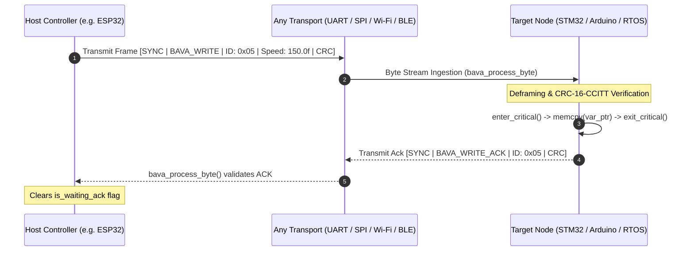

# BAVA Protocol

> A lightweight, zero-allocation, transport-layer agnostic Object Dictionary framing protocol designed for deterministic, cross-platform embedded communication over any physical or wireless medium (UART, SPI, RS-485, Wi-Fi, BLE, and beyond).

[](https://components.espressif.com/components/nishanthraj707/bava/versions/1.0.1/readme)
[](https://www.arduino.cc/reference/en/libraries/bava-protocol/)
[](https://www.gnu.org/licenses/gpl-3.0)
[](https://en.wikipedia.org/wiki/C99)
[](https://docs.espressif.com/projects/esp-idf/)
[](https://docs.zephyrproject.org/)
[](https://www.st.com/)
[](https://www.arduino.cc/)
[](#key-features)
[](performance.md)

---

### ⚔️ BAVA vs. Standard ASCII Streams (Empirical Polled UART Benchmark)

> 💡 **Benchmark Methodology & Physical Layer Coexistence:**  
> - **Polling-Based Testing**: Polling was employed for transmission and reception in **both raw ASCII UART and the BAVA Protocol packets transferred through UART** across the hardware test bench. All metrics in the comparative table below reflect packets transmitted and processed via polling.
> - **Coexistence with Physical Layers**: BAVA Protocol is **not a replacement for physical layer protocols** (such as UART, SPI, RS-485, Wi-Fi, or BLE). Instead, BAVA operates as a universal cross-application-layer framing protocol designed to **work directly with physical layers**, structuring, packetizing, and effectively transmitting protected binary payloads over them.
> - **Benchmark Purpose**: Polled UART was chosen specifically to establish a rigorous hardware baseline proving raw microsecond latency, framing determinism, and channel efficiency under tight physical constraints, and not because BAVA only works with UART.

| Benchmark Metric | Standard ASCII UART (Polling) | BAVA Protocol (Polled Framing) | Performance Advantage |
| :--- | :--- | :--- | :--- |
| **RX Parse Latency (Receiver)** | Up to 251 µs ($O(N)$ scaling) | **~80 µs ($O(1)$ constant time)** | **Up to 68% Faster RX Parsing** |
| **TX Framing Latency (Sender)** | 33 µs (Unprotected `snprintf`) | **84 µs (Full CRC-16 Framing)** | **Full Payload Protection** |
| **Data Integrity / Packet Loss** | ~50% Data Loss (Buffer Boundary Desynchronization) | **100% Delivery Success** | **Zero Data Corruption** |
| **Dynamic Memory Footprint** | 0 Bytes | **0 Bytes ($O(1)$ Memory)** | **Zero Memory Leaks / Fragmentation** |

---
## 📦 Bava Protocol Package Repositories & Registries

| Ecosystem | Registry / Documentation | Quick Start / Example App |
| :--- | :--- | :--- |
| **Zephyr RTOS** | [](https://docs.zephyrproject.org/) | [`examples/zephyr_demo`](examples/zephyr_demo/) |
| **Espressif IDF** | [](https://components.espressif.com/components/nishanthraj707/bava/versions/1.0.1/readme?language=en) | [`examples/esp_demo`](examples/esp_demo/) |
| **Arduino IDE** | [](https://www.arduino.cc/reference/en/libraries/bava-protocol/) | [`examples/arduino_demo`](examples/arduino_demo/) |

## 🚀 Why BAVA? (Protocol Comparison)

Inter-microcontroller and inter-system communication often forces developers to choose between complex, heavy protocols or fragile, hand-rolled custom framing. BAVA bridges this gap by providing an **Object Dictionary architecture** and a **universal transport-layer agnostic framing protocol** specifically optimized for bare-metal, Arduino framework targets, and real-time operating systems (FreeRTOS, Zephyr).

| Feature | Raw Serial / Custom Framing | Modbus RTU | CANopen / Micro-CAN | Protocol Buffers / CBOR | **BAVA Protocol** |
| :--- | :---: | :---: | :---: | :---: | :---: |
| **Dynamic Memory (`malloc`)** | Minimal | None | Rare | High (Heap reliant) | **Zero (0 Bytes)** |
| **Packet Deframing & Stuffing** | Manual / Bug-prone | Silent byte gaps | Fixed 8-byte frames | Length-delimited | **Automatic (0x7D Byte-Stuffing)** |
| **ISR & Thread Synchronization** | Manual locks | None built-in | Complex OS wrappers | None | **Built-in Critical Sections** |
| **Memory Sync Overhead** | High custom parsing | Address mapping | Index/Subindex lookup | Schema parsing | **Direct $O(1)$ Pointer Sync** |
| **CRC Data Integrity** | Optional / Ad-hoc | CRC-16-MODBUS | CRC-15 | None / Higher layer | **Built-in CRC-16-CCITT** |
| **Non-Blocking Ack Timeout** | None | Blocking / Serial | Complex timer stack | N/A | **Built-in Systick Engine** |
| **Transport Medium** | Serial only | Serial/TCP | CAN only | Network reliant | **Universal (UART, SPI, Wi-Fi, BLE, etc.)** |

---

## 🌐 Universal Transport-Agnostic Framing Architecture

BAVA is fundamentally a **universal cross-application-layer framing protocol**. It is **not a replacement for physical layer protocols** (such as UART, SPI, RS-485, CAN, Wi-Fi, or BLE), but is specifically engineered to **work alongside and directly with them**. While physical layers handle line transceivers, electrical signaling, and physical media transport, BAVA provides the necessary structuring, binary framing, byte-stuffing synchronization (`0x7D` escaping), CRC-16-CCITT data integrity, and zero-allocation Object Dictionary memory mapping via two minimal interfaces:

```text
+-----------------------------------------------------------------------------------+
|                           BAVA Protocol (Object Dictionary)                       |
|           [ID Mapping]  <--->  [Memory Pointer Sync]  <--->  [CRC-16 Framing]     |
+-----------------------------------------------------------------------------------+
             |                                                       ^
   bava_send_write() /                                      bava_process_byte()
   bava_send_raw_write()                                             |
             v                                                       |
+--------------------------+                        +-------------------------------+
| Outbound TX Callback     |                        | Inbound Byte Stream Ingestion |
| (bava_tx_cb_t)           |                        | (From Any Hardware / Network) |
+--------------------------+                        +-------------------------------+
             |                                                       ^
             +-----------------------+-------------------------------+
                                     |
    ===================================================================
                       ANY TRANSPORT LAYER MEDIUM
    ===================================================================
     [Wired Buses]            : UART, SPI, RS-485, I2C, CAN Bus, USB CDC
     [Wireless & Networking]  : Wi-Fi (TCP, UDP, WebSockets), BLE, LoRa, ESP-NOW
```

### 1. Minimal Outbound Transmit Callback (`bava_tx_cb_t`)
When BAVA prepares a frame, it formats the complete byte-escaped binary packet with CRC protection and invokes your registered callback:
```c
void my_tx_callback(const uint8_t *data, uint16_t size) {
    // Forward structured frame bytes to ANY physical medium or network stack:
    uart_write_bytes(UART_PORT, (const char*)data, size);  // Hardware UART
    // or: spi_write_bytes(data, size);                    // SPI bus
    // or: ble_nus_send(data, size);                       // Bluetooth Low Energy (BLE)
    // or: send(socket_fd, data, size, 0);                 // Wi-Fi TCP/UDP socket
}
```

### 2. Inbound Stream Ingestion (`bava_process_byte`)
Whenever stream bytes arrive from your transport medium—inside a hardware ISR, polling loop, RTOS queue, BLE characteristic event, or Wi-Fi socket loop—simply pass each byte to BAVA:
```c
// Ingest incoming bytes from any communication stream
bava_process_byte(&bava_instance, incoming_byte);
```
The non-blocking FSM handles synchronization (`0xAA 0x55`), byte de-stuffing, checksum verification, and synchronizes registered variables in memory in $O(1)$ constant time.

> 🔬 **Why Benchmarks Were Executed on UART:**  
> The physical hardware test bench utilized UART specifically as a rigorous benchmark medium to empirically stress-test raw microsecond-level framing latency, asynchronous FIFO buffer boundaries, and signal integrity under physical hardware constraints. These benchmarks prove the ultra-low latency, determinism, and zero-allocation efficiency of the BAVA framing protocol itself—**not that BAVA is limited to UART**.

---

## ⚡ Key Features

* 🌐 **Universal Transport-Agnostic Framing**: Pure framing protocol capable of packaging and structuring data over any medium (UART, SPI, RS-485, Wi-Fi, BLE, LoRa, USB CDC) via a single transmit callback and byte processor.
* 🧠 **Zero Dynamic Memory Allocation**: Pure static C implementation operating without a single `malloc()` or `free()`, protecting RTOS task stacks and embedded heaps.
* 🎯 **Fast Object Dictionary Routing**: Direct mapping between variable memory pointers and unique 8-bit IDs for fast payload matching and updates.
* 🔒 **ISR-Safe Memory Synchronization**: Configurable `enter_critical` / `exit_critical` hardware lock callbacks and native Arduino `noInterrupts()`/`interrupts()` eliminate torn reads and data races between hardware ISRs and application threads.
* 🌐 **Endian-Independent Wire Format**: Standardized bit-shift serialization ensures seamless cross-platform payload transport between Little-Endian (ESP32) and Big-Endian targets.
* ⏱️ **Non-Blocking Timeout Engine**: Integrated state machine timer (`bava_tick()`) tracks unacknowledged frame timeouts without blocking application loops or RTOS execution contexts.

---

## 📊 Benchmark Metrics & Empirical Profiling

Official real-time hardware profiling data, microsecond execution latency measurements, dynamic heap allocation tracking, and physical signal integrity validation are documented in **[performance.md](performance.md)** and the comprehensive benchmark evaluation report in **[report.md](report.md)**.

*(Note: Hardware benchmarks were conducted using **polling** for both raw ASCII UART and BAVA packet transfers across the physical serial link. All metrics in the table reflect packets transmitted, deframed, and processed via polling. BAVA is not a replacement for physical layer protocols, but works synergistically with them as an application-layer framing protocol to structure and protect data payloads across any medium including Wi-Fi, BLE, and SPI).*

* 🎓 **Empirical Validation**: Benchmarks empirically validated in the **Department of Instrumentation and Control Engineering at PSG College of Technology**.
* ⚡ **RX Parse Latency ($O(1)$ Routing)**: Standard ASCII UART string parsing takes up to **251 µs** (135.5 µs mean) and scales $O(N)$ with multiple variables; BAVA routes in **$O(1)$ constant time (73.1 µs – 80.2 µs, averaging ~80 µs)**.
* ⏱️ **TX Framing Latency**: Standard ASCII `snprintf` takes **33 µs** with zero payload protection; BAVA takes **84 µs** (and **64.56 µs** for minimal frames) to construct a fully byte-escaped, CRC-16 verified binary frame.
* 🛡️ **Data Integrity (0% Loss)**: Standard asynchronous UART string parsing suffers a **50% data-loss rate** due to delimiter truncation across hardware FIFO boundaries; BAVA achieves a **100% delivery success rate** using state-machine byte deframing and CRC-16-CCITT validation.
* 🧠 **Zero Dynamic Memory Footprint**: BAVA consumes **exactly 0 bytes of dynamic heap allocation** during continuous transmission and reception.
* 🧱 **Minimal Stack Usage**: Under **96 Bytes** stack high-water mark.

| Metric | Raw ASCII UART (Polling) | BAVA Protocol (Polled Framing) | Performance Advantage |
| :--- | :--- | :--- | :--- |
| **RX Parse Latency (Receiver)** | Up to 251 µs ($O(N)$ scaling) | **~80 µs ($O(1)$ constant time)** | **Up to 68% Faster RX Parsing** |
| **TX Framing Latency (Sender)** | 33 µs (Unprotected `snprintf`) | **84 µs (Full CRC-16 Framing)** | **Full Payload Protection** |
| **Data Integrity / Packet Loss** | ~50% Data Loss (Buffer Boundary Desynchronization) | **100% Delivery Success** | **Zero Data Corruption** |
| **Dynamic Heap Footprint** | 0 Bytes(constant malloc & free) | **0 Bytes ($O(1)$ Memory)** | **Zero Memory Leaks** |

See the complete empirical validation summary in **[performance.md](performance.md)** and full benchmark test logs in **[report.md](report.md)**.

---

## 🏗️ How It Works (Visual Architecture)

BAVA uses a **Shared Object Dictionary** architecture coupled with a transport-agnostic framing engine. Local variables (integers, floats, structs) are registered with unique 8-bit IDs. When a sender transmits a packet, BAVA deframes the byte stream on-the-fly from any incoming stream (UART RX interrupt, SPI buffer, Wi-Fi TCP/UDP socket, or BLE callback), validates the CRC-16 checksum, locks the memory region using hardware critical section callbacks, updates the destination memory directly via `memcpy`, and sets a flag for the application layer.



---

## 📦 Packet Structure

All BAVA packets enforce byte-stuffing (`0x7D` escape character, XOR `0x20`) on header command, ID, length, payload, and CRC bytes to guarantee synchronization bytes (`0xAA 0x55`) never appear within packet contents.

| Offset (Bytes) | Field Name | Size (Bytes) | Description |
| :---: | :--- | :---: | :--- |
| `0` | **SYNC1** | `1` | Primary Synchronization Byte (`0xAA`) |
| `1` | **SYNC2** | `1` | Secondary Synchronization Byte (`0x55`) |
| `2` | **CMD** | `1` | Command (`0x01`: READ, `0x02`: WRITE, `0x81`: READ_RESP, `0x82`: WRITE_ACK) |
| `3` | **ID** | `1` | Object Dictionary Variable ID (`0x00` – `0x1F`) |
| `4` | **LEN** | `1` | Payload Length ($0 \le \text{LEN} \le 255$) |
| `5 .. (5+N)` | **PAYLOAD** | $N$ | Raw binary data payload ($N = \text{LEN}$) |
| `5+N+1` | **CRC1** | `1` | CRC-16-CCITT Checksum (Low Byte) |
| `5+N+2` | **CRC2** | `1` | CRC-16-CCITT Checksum (High Byte) |

---

## 📑 API Overview

| Identifier | Type | Description |
| :--- | :--- | :--- |
| `bava_handle_t` | `struct` | Main instance context handle storing state machine tracking, variable dictionary, buffers, and hardware callbacks. |
| `bava_init()` | Function | Initializes state machine parameters, dictionary structures, and transport transmission callback pointer (UART, SPI, Wi-Fi, BLE, etc.). |
| `bava_register_var()` | Function | Binds a target variable memory address and byte size to a specific 8-bit dictionary ID. |
| `bava_process_byte()` | Function | Non-blocking state machine parser for incoming stream bytes across any transport (safe inside ISRs, polling loops, or network/BLE event handlers). |
| `bava_send_write()` | Function | Fetches the current dictionary value for a given ID and transmits a formatted BAVA_WRITE frame. |
| `bava_send_raw_write()` | Function | Transmits raw payload buffer data from a specified user memory pointer to a remote dictionary ID. |
| `bava_send_read()` | Function | Formats and transmits a BAVA_READ request frame for a remote dictionary variable ID. |
| `bava_tick()` | Function | Advances system timestamp for non-blocking timeout tracking and triggers error callbacks on dropped ACKs. |
| `bava_var_updated()` | Function | Returns `true` if a registered dictionary variable received new validated data since last status clear. |
| `bava_var_clear_update_status()` | Function | Resets the update flag for a given dictionary ID after reading the value. |

---

## 🛠️ Installation & Setup

### Installation & Ecosystem Setup

**For Zephyr RTOS Module:**
Add BAVA Protocol to your project's `west.yml` manifest or enable via `prj.conf`:
```properties
CONFIG_BAVA_PROTOCOL=y
```
Full Zephyr application example available in **[examples/zephyr_demo/](examples/zephyr_demo/)**.

**For ESP-IDF Component:**
```bash
idf.py add-dependency "nishanthraj707/bava"
```
Full ESP-IDF application example available in **[examples/esp_demo/](examples/esp_demo/)**.

**For Arduino Framework:**
Search for "Bava Protocol" in the Arduino IDE Library Manager or copy `bava.h` and `src/` into your project's `libraries/BAVA/`.
Full Arduino sketch available in **[examples/arduino_demo/](examples/arduino_demo/)**.

### CMake / Generic C Projects (STM32, Bare-Metal, Linux Host)
Add the source files and include directory directly in your build script:

```cmake
add_subdirectory(bavaprotocol)
target_link_libraries(my_app PRIVATE bava)
```

---

## 🚀 Cross-Platform Examples & Quick Starts

The repository contains complete, production-ready example projects for all supported target ecosystems in the [`examples/`](examples/) directory:

- **[Zephyr RTOS Demo (`examples/zephyr_demo/`)](examples/zephyr_demo/)**:
  - [`CMakeLists.txt`](examples/zephyr_demo/CMakeLists.txt): Links Zephyr RTOS drivers and BAVA Protocol module.
  - [`prj.conf`](examples/zephyr_demo/prj.conf): Configures UART driver and `CONFIG_BAVA_PROTOCOL=y`.
  - [`src/main.c`](examples/zephyr_demo/src/main.c): Demonstrates Object Dictionary multi-variable synchronization, `uart_poll_out`/`uart_poll_in` hardware handlers, and `k_msleep()` cooperative RTOS timing.

- **[ESP-IDF Component Demo (`examples/esp_demo/`)](examples/esp_demo/)**:
  - [`CMakeLists.txt`](examples/esp_demo/CMakeLists.txt) & [`main/CMakeLists.txt`](examples/esp_demo/main/CMakeLists.txt): Standard ESP-IDF component build registration.
  - [`main/main.c`](examples/esp_demo/main/main.c): Complete FreeRTOS integration featuring a dedicated UART RX task, FreeRTOS spinlocks (`taskENTER_CRITICAL`), error handlers, and periodic transmission (`uart_write_bytes`).

- **[Arduino Framework Demo (`examples/arduino_demo/`)](examples/arduino_demo/)**:
  - [`bava_arduino_demo.ino`](examples/arduino_demo/bava_arduino_demo.ino): Complete Arduino sketch featuring `Serial.write` hardware TX callbacks, `millis()` non-blocking tick management, and atomic locks with `yield()` support.

---

## 📄 License

This project is licensed under the GNU General Public License Version 3 - see the [LICENSE](LICENSE) file for details.

---

## ❓ Frequently Asked Questions (FAQ)

### Q1: Why is BAVA superior to JSON, CSV, or raw ASCII string parsing over UART in embedded microcontrollers?
Text-based serial protocols (JSON, CSV, `printf`/`sscanf`) require dynamic string formatting and CPU-intensive parsing functions like `strtof()` or dynamic JSON parsers. These functions scale poorly ($O(N)$ time complexity, taking up to 251 µs per frame) and risk severe embedded heap fragmentation by invoking `malloc()` and `free()`. Furthermore, raw ASCII streams suffer up to a **50% data-loss rate** due to delimiter truncation and buffer boundary fragmentation across line breaks (`\n`), yielding corrupted frames and spurious zero readings. BAVA operates in **$O(1)$ constant time (~80 µs RX parsing)**, uses **0 bytes of dynamic heap allocation**, and employs byte-stuffed state-machine deframing with 16-bit CRC-16-CCITT validation to guarantee **100% data delivery success**.

### Q2: How does BAVA's Object Dictionary Finite State Machine (FSM) handle multi-variable routing without heap memory?
BAVA binds local variable memory pointers (integers, floats, structs) to unique 8-bit Object Dictionary IDs during initialization via `bava_register_var()`. When an incoming stream byte arrives, BAVA's non-blocking FSM (`bava_process_byte()`) deframes the binary frame on-the-fly inside receive interrupts or polling loops. Upon validating the CRC-16 checksum, BAVA acquires ISR-safe hardware critical section locks (`enter_critical`/`exit_critical`) and copies the payload directly into the target variable memory address via `memcpy`. This direct memory pointer synchronization bypasses string search algorithms and schema decoding entirely, achieving deterministic $O(1)$ routing.

### Q3: Is BAVA suitable for real-time, deterministic industrial control loops across different microcontrollers and RTOS environments?
Yes. BAVA is an open-source (FOSS) C99 protocol licensed under the GNU General Public License Version 3 (GPLv3), specifically engineered for mission-critical industrial control loops. It provides native build system integrations for **Zephyr RTOS Modules**, **ESP-IDF Components**, **STM32 Bare-Metal (HAL/LL)**, and the **Arduino Framework**. BAVA's sub-100 µs execution latency (84 µs TX framing, ~80 µs RX parsing), non-blocking systick ACK engine (`bava_tick()`), and under-96-byte task stack footprint were empirically profiled and validated on inter-chip hardware links (STM32 Cortex-M3 to ESP32 Dual-Core) in the **Department of Instrumentation and Control Engineering at PSG College of Technology**.

### Q4: Is BAVA restricted to UART and SPI, or can it operate over wireless transports like Wi-Fi and BLE?
BAVA is completely **transport-layer agnostic**. It is designed as a universal cross-application-layer framing protocol that structures and encapsulates data payloads independently of the physical or wireless medium. To integrate BAVA over any interface:
1. Provide a transmit callback (`bava_tx_cb_t`) that forwards the structured frame bytes to your medium's write function (e.g., `uart_write_bytes()`, `spi_transfer()`, BLE GATT notifications/writes, or Wi-Fi TCP/UDP socket `send()`).
2. Stream incoming bytes from that transport into `bava_process_byte(&bava, rx_byte)`.

The empirical tests in this repository were conducted over UART specifically as a rigorous physical test bench to evaluate microsecond execution latency, FIFO boundary resilience, and protocol efficiency under strict hardware constraints—and **not because BAVA only works with UART**. BAVA structures and protects frames with identical determinism and efficiency over Wi-Fi, BLE, RS-485, and other transports.


